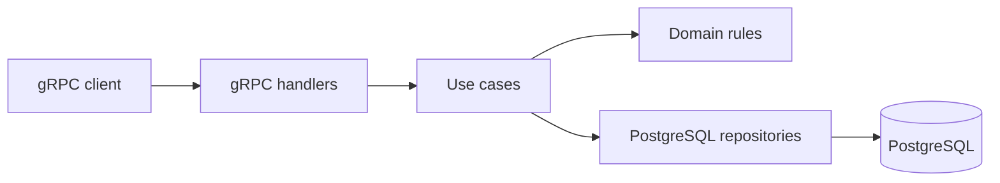

# DoubleLedger

A double-entry accounting service written in **Go**, accessible through **gRPC**.

This document defines what we want to build, the rules we must enforce, and an initial system design. It will evolve during development: choices marked as proposals may change before implementation.

## Goal

Build a reliable ledger that supports creating accounts, posting balanced journal entries, and querying postings and balances. The project also provides a way to develop and understand a complete Go system, from domain rules to persistence and gRPC APIs.

The first milestone is a complete workflow: create two accounts, post a journal entry, verify their balances, and retry the request without duplicating postings.

## First version scope

- A single ledger and a single currency configured for the service.
- Account creation and retrieval.
- Atomic journal entry posting with at least two debit/credit lines.
- Paginated queries for journal entries and account postings.
- Account balance queries.
- Idempotent journal entry posting.
- PostgreSQL persistence and gRPC APIs defined with Protocol Buffers.
- Domain rule tests and database integration tests.

The first version excludes a graphical interface, real payments, currency exchange, multi-tenancy, tax reports, fund reservations, and spending limits. The ledger records accounting facts; it does not execute transfers through banks or payment providers.

## Accounting rules and guarantees

1. Each journal entry contains at least two postings, and total debits must equal total credits.
2. Each posting specifies an existing account, a side (debit or credit), and a strictly positive amount.
3. Amounts use 64-bit integers in the currency's smallest unit: for EUR, `1050` means `10.50 EUR`. No `float32` or `float64`; arithmetic and conversions must check for overflow.
4. A journal entry is saved in full or not saved at all. Partial entries must never be visible.
5. Posted journal entries are immutable. Corrections require a new compensating entry, preserving the history.
6. Reusing an idempotency key with the same payload returns the existing journal entry. Reusing it with a different payload produces a conflict.
7. Balances are derived from posted accounting lines. The first version does not maintain a separate, independently mutable balance.
8. Both positive and negative balances are allowed. Constraints such as overdraft prevention require additional rules and are outside the initial scope.

Debit and credit are accounting sides, not universal synonyms for increases and decreases. For an account with a normal debit balance, the balance is `total debits - total credits`; for an account with a normal credit balance, it is `total credits - total debits`. The API also exposes both totals to avoid ambiguity.

### Example

Receiving 100 EUR for a service:

| Account | Debit | Credit |
| --- | ---: | ---: |
| Cash (asset) | 100.00 EUR | — |
| Service revenue (revenue) | — | 100.00 EUR |

The journal entry is balanced. The normal balance of cash increases by 100 EUR, and the normal balance of revenue increases by 100 EUR.

## Proposed domain model

| Entity | Responsibility | Main fields |
| --- | --- | --- |
| Account | Identifies a ledger account | ID, unique code, name, type, creation timestamp |
| JournalEntry | Represents a posted journal entry | ID, description, idempotency key, posting timestamp, postings |
| Posting | Represents a line within a journal entry | ID, journal entry ID, account ID, side, amount |

Initial account types: asset, liability, equity, expense, and revenue. Assets and expenses have a normal debit balance; the others have a normal credit balance.

Initial proposal: service-generated UUIDs and server-assigned posting timestamps in UTC. Backdated entries, accounting periods, and period closing will be addressed separately.

## Initial system design

A single Go service and a PostgreSQL database. Microservices, queues, and event sourcing are unnecessary for the first goal. The accounting history remains immutable within the relational model.



- **Transport:** decodes requests, invokes use cases, and maps errors to gRPC status codes.
- **Application:** coordinates account creation, journal entry posting, transactions, and idempotency.
- **Domain:** defines entities, amounts, and accounting rules without depending on gRPC or the database.
- **Persistence:** implements queries and transactions, with database constraints providing additional integrity guarantees.

### Posting a journal entry

1. Validate the format, postings, amounts, and balance.
2. Open a database transaction and verify that the accounts exist.
3. Insert the journal entry, postings, and idempotency data within the same transaction.
4. Commit and return the posted journal entry.

A unique constraint on the idempotency key must also handle concurrent requests: a preliminary lookup alone is insufficient. When a key already exists, compare the normalized accounting payload and return either the existing result or a conflict. If the client loses the response after the commit, it can retry with the same key.

The SQL constraints needed to enforce balanced entries at the database level, and the transaction isolation level, must be defined during the persistence phase and verified with concurrency tests.

### Balances and reads

Initially, balances are calculated by aggregating persisted postings. Each balance response must read debit and credit totals in a single consistent query. Separate calls do not share a guaranteed snapshot.

Account postings will use stable ordering and cursor pagination. Indexes and potential balance projections will be evaluated using actual measurements; any projections must remain rebuildable from journal entries.

## Proposed gRPC API

A versioned contract in the `ledger.v1` package.

| Method | Purpose |
| --- | --- |
| `CreateAccount` | Create an account with a unique code and accounting type |
| `GetAccount` | Retrieve an account |
| `ListAccounts` | List accounts with pagination |
| `PostJournalEntry` | Post a journal entry with a required idempotency key |
| `GetJournalEntry` | Retrieve a journal entry and its postings |
| `ListJournalEntries` | List journal entries with pagination |
| `ListAccountPostings` | Retrieve account postings with pagination |
| `GetAccountBalance` | Retrieve debit/credit totals and the normal balance |

Expected errors: `InvalidArgument` for invalid requests, `NotFound` for missing resources, `AlreadyExists` for duplicate codes or idempotency conflicts, and `Internal` for unexpected failures without exposing database details.

The `.proto` file will be the source of truth for the contract; Go transport code will be generated and will not be edited manually.

## Proposed repository structure

```text
api/proto/ledger/v1/    # Protocol Buffers contracts
cmd/ledger/            # Service startup and configuration
internal/domain/       # Entities and accounting rules
internal/application/  # Use cases and persistence interfaces
internal/postgres/     # PostgreSQL repositories and transactions
internal/grpc/         # Handlers and error mapping
migrations/            # Versioned SQL migrations
```

Directories will be introduced when they contain concrete implementations, avoiding empty structures and premature abstractions.

## Development plan

### 1. Accounting domain

Define accounts, amounts, postings, and journal entries. Implement validation and tests for balancing, invalid amounts, and overflow.

**Done when:** accounting rules are executable and tested without a database or network.

### 2. gRPC contract

Write the `.proto`, define messages, pagination, and errors, and set up reproducible Go code generation.

**Done when:** the contract compiles and supports the first milestone's workflow.

### 3. Persistence and use cases

Add the schema, migrations, PostgreSQL repositories, and transactions. Implement posting, idempotency, and reads.

**Done when:** integration tests verify rollbacks, balances, duplicate keys, and concurrent requests without duplicate entries.

### 4. Runnable service

Connect handlers to use cases. Add configuration, local startup with PostgreSQL, health checks, timeouts, and graceful shutdown.

**Done when:** a gRPC client can create accounts, post a journal entry, and read balances; retrying returns the same journal entry ID.

### 5. First release verification

Document the actual startup commands and a complete example. Run end-to-end tests, static checks, and the race detector; add reproducible CI.

**Done when:** the documented workflow works from a clean checkout and automated checks pass.

## Decisions to confirm during development

- Available Go toolchain and dependency versions; the initial `go.mod` declares `go 1.27`.
- Protocol Buffers generation and migration tooling.
- PostgreSQL driver and query approach: the initial proposal is explicit SQL without an ORM.
- Currency and decimal precision for the first environment.
- Request limits: maximum posting count, amounts, and page sizes.
- SQL constraints, isolation strategy, and protection against changes to accounting history.

Before exposing the service beyond the local environment, we need concrete decisions on authentication, authorization, TLS, backups, and recovery. These are outside the first local workflow.

## Local development

Install Go 1.27 or later and ensure `go` is available on your `PATH`. The bootstrap has been verified with Go 1.27.3.

```sh
go run .
go vet ./...
go test -race ./...
go build ./...
```

The executable currently prints a placeholder message and exits. PostgreSQL and Protocol Buffers tooling will be introduced in their respective implementation phases.

GitHub Actions checks formatting, runs vet and tests with the race detector, and builds the project on pushes and pull requests. There are no tests yet; domain tests will arrive with the accounting domain.

## Current status

The bootstrap includes the Go module, a minimal executable, local development instructions, and CI. The ledger and gRPC APIs are not implemented yet. The next step is phase 1: modeling the domain and verifying its rules.
